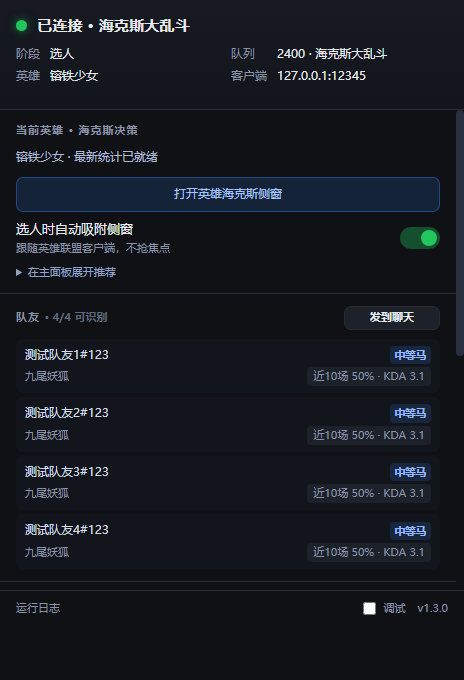
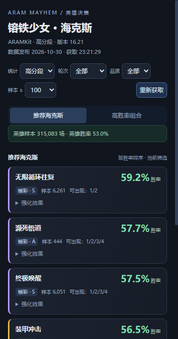
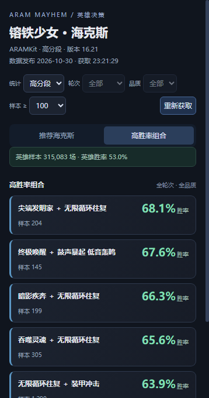

# 海斗助手 · HaiDou Assistant

> 英雄联盟客户端辅助工具（C# / WinForms + WebView2）—— 选人阶段实时查看英雄海克斯与真实组合胜率、队友战绩、按住 Tab 看经济差。
>
> **只用 Windows 自带的 .NET Framework 4.8 与系统 WebView2，程序本体 132 KB，整个分发目录 1.1 MB。**

当前版本：**1.3.1**（2026-11-10）· 编译：Windows 自带 `csc.exe`（无需 SDK / VS / Node）

---

## 截图

**主面板** —— 连接状态、阶段、英雄、队友战绩（马评）、参数折叠区、运行日志



**英雄海克斯** —— 选人后按当前英雄实时拉取，展示品质、样本、来源评级、可展开效果



**高胜率组合** —— 直接使用数据源的共同选取统计，不做单个胜率相乘



---

## 下载与使用

1. 到 [Releases](../../releases) 下载最新的 `HaiDouAssistant-1.3.1-win64.zip`。
2. 解压到**任意可写目录**（例如 `D:\Tools\HaiDouAssistant`，不要放在 `C:\Program Files` 这类需要管理员权限的位置）。
3. 双击 `HaiDouAssistant.exe`。
   - 先开英雄联盟客户端，再开助手；助手会自己找客户端的本地端口与 token。
   - 面板显示「已连接」即成功。
4. 需要退出时用托盘图标右键 → 退出（关窗口只是收进托盘）。

**再次双击 exe 可以唤回已经收进托盘的窗口**（第二个实例会把信号发给第一个实例）。

### 运行要求

| 项 | 说明 |
|---|---|
| 系统 | Windows 10 1809+ / Windows 11 |
| WebView2 运行时 | Win11 自带；Win10 多数随 Edge 更新已装。缺失时程序会弹窗提示，到微软官网搜 "WebView2 Runtime" 装一次即可 |
| .NET Framework 4.8 | Windows 10 1903+ 自带 |
| 游戏 | 英雄联盟国服客户端（工具读取客户端本地 LCU 接口，不改游戏内存、不注入进程） |

运行期数据（配置、启动日志、WebView2 缓存）都在 exe 同目录的 `hxdou-data\`，整个目录可以直接搬走备份。

---

## 功能

| 功能 | 状态 |
|---|---|
| 选英雄后实时拉取海克斯（推荐 + 真实组合胜率） | ✅ 1.3.0 |
| 选人自动吸附侧窗（贴客户端右侧 / 左侧 / 屏幕内浮动，不抢焦点） | ✅ 1.3.0 |
| 按住 <kbd>Tab</kbd> 经济差浮层（透明 / 置顶 / 点击穿透 / 不抢焦点） | ✅ 已实测显示正常 |
| 自动接受对局（随机延迟、队列白名单、失败冷却重试） | ✅ |
| 队友信息（名字 / 近 10 场胜率 / KDA / 马评） | ✅ |
| 选人阶段把战绩发到聊天（5 通道回退，每位队友单独一条） | ✅ |
| 托盘图标 + 菜单（面板常驻最前开关） | ✅ |
| 面板（状态灯 / 开关 / 队友 / 路径 / 日志） | ✅ |
| 调试页（16 个按钮，全部接通，程序内独立窗口） | ✅ |
| WSS 事件流（`OnJsonApiEvent_lol-gameflow_v1_gameflow-phase`，轮询兜底） | ✅ |
| 自检 `--selftest`（21 项，无需客户端） | ✅ |
| 选人自动出装 | ❌ 1.2.0 已移除（保留旧文件清理） |

海克斯统计的筛选：段位（高分段 / 全段位）、轮次、品质、样本门槛，默认高分段 + 至少 100 样本；组合页固定全轮次全品质（轮次/品质筛选会禁用），样本门槛仍生效。

---

## 为什么能这么小

| 组件 | Electron 版 | 本版 |
|---|---|---|
| 浏览器内核 | 打包 Chromium（`HaiDouAssistant.exe` 本体 201 MB + locales 44 MB + 一堆 DLL） | **复用系统 WebView2**（Win10/11 自带，不计入包体） |
| 网络/文件/JSON | Node 运行时（也在 Electron 里） | .NET Framework 4.8（Windows 自带） |
| 我们的代码 | app.asar 464 KB | `HaiDouAssistant.exe` 132 KB |
| 界面 | HTML/CSS/JS | **同一套** HTML/CSS/JS |
| 合计（解压/目录） | 约 352 MB | **1.1 MB** |
| 便携 exe | 97.7 MB | 不需要打包，直接拷目录 |

---

## 目录结构

```
hxdou-cs\
├─ build.bat                一键编译（用 Windows 自带 csc，不需要装 SDK）
├─ test.bat                 编译 + --selftest
├─ app.ico
├─ src\
│  ├─ App.cs                路径解析 / 配置 / 启动日志
│  ├─ LcuClient.cs          LCU 连接（WMI 取端口 token）+ HTTPS 请求
│  ├─ Maps.cs               英雄/装备数据、出装文件写入、LoL 目录探测
│  ├─ Engine.cs             阶段机 / 队友 / 经济差 / 自动接受 / 聊天播报
│  ├─ HexData.cs            海克斯在线请求、规范化、请求代次隔离
│  ├─ HexWindow.cs          选人侧窗、原生窗口识别、吸附与前台跟随
│  ├─ HexTests.cs           海克斯相关自检
│  ├─ UI.cs                 透明置顶浮层（Tab）+ 托盘
│  ├─ Debug.cs              调试页后端（16 个动作）
│  ├─ SelfTest.cs           --selftest 入口
│  └─ Program.cs            窗口、WebView2 桥接、IPC 分发
├─ wwwroot\                 panel.html / hex.html / debug.html / hex-view.js / hex.css
├─ data\                    builds-flat.json（构建期展平）+ 英雄/装备映射
├─ lib\                     WebView2 SDK 引用（Microsoft.Web.WebView2.*.dll、WebView2Loader.dll）
├─ tools\                   gen-builds-flat.js / check-ui.js / UiSmoke.cs / verify-hex-live.ps1
├─ docs\                    版本说明、上机验证清单、维护手册、截图
└─ out\                     编译产物（== 分发目录，未纳入版本库）
```

---

## 编译

双击 `build.bat`，或者：

```bat
cd hxdou-cs
build.bat
```

用的是 `C:\Windows\Microsoft.NET\Framework64\v4.0.30319\csc.exe`（Windows 自带），**不需要安装 .NET SDK / Visual Studio / Node**。

产物在 `out\`：`HaiDouAssistant.exe` + `lib\*.dll` + `wwwroot\` + `data\` + `app.ico`，整个目录就是分发目录。

## 自检

```bat
test.bat
```

`build.bat` 之后跑 `HaiDouAssistant.exe --selftest`，失败退出码为 1。当前 **21 项**覆盖：数据加载、阈值、数值格式、阶段、配置、聊天组包、自动接受（状态复位/队列/取消/冷却/并发）、强制 GC 后轮询、装备计价与实时刷新、四条聊天与部分失败回退、移除推荐及安全清理旧文件、海克斯选人联动/统计解析/换英雄重查/失败清空/响应顺序、吸附位置（左右/空间不足/负坐标）。

界面静态检查（只需 Node，构建和运行都不需要）：`node tools/check-ui.js`。

---

## 数据来源与边界

- 海克斯数据来自 **ARAMKit 公开统计**（实时查询最新已发布版本，不保存推荐缓存，不回退到静态推荐）。国内端点失败时改查同源国际端点的最新版本。
- 高胜率组合只展示数据源发布的组合统计，**不计算单海克斯胜率乘积**，不能当作全部组合的完整榜单。
- 实时获取指每次查询最新已发布的统计，不代表源站逐秒更新；失败时展示错误与重试入口，不把缺失数据显示成 0%。
- 队友战绩来自 LCU 本地接口；助手只读本地客户端 API，不读写游戏内存、不注入进程、不改客户端文件。
- 上机验证项见 [docs/VERIFY-CHECKLIST.md](docs/VERIFY-CHECKLIST.md)。

## 文档

- [docs/RELEASE-1.3.1.md](docs/RELEASE-1.3.1.md) —— 本版更新说明
- [docs/VERIFY-CHECKLIST.md](docs/VERIFY-CHECKLIST.md) —— 真机验证清单
- [docs/TODO.md](docs/TODO.md) —— 待办与已知差异
- [docs/HEX-DATA-RESEARCH.md](docs/HEX-DATA-RESEARCH.md) —— 海克斯数据源调研
- [docs/CHANGELOG.md](docs/CHANGELOG.md) —— 历史版本（1.1 / 1.2.0）与调试页明细

---

## 已知差异 / 后续

1. 面板常驻最前的配置项还没和面板 UI 联动（托盘菜单里已有开关）。
2. 运行期数据都在 `hxdou-data\`（配置、启动日志、WebView2 缓存数十 MB）—— 跟 exe 同目录，可整体搬走。
3. 打包成单文件可以做，但会把 WebView2 依赖拆散；现在 17 个文件 1.1 MB 已经够小。
